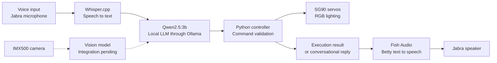

# Z.O.E.-project-LLM
# ZOE — Voice-Controlled Robotic Aircraft Platform

ZOE is a stationary robotic aircraft inspired by the Z.O.E. concept from the Ace Combat series. It combines a local language model, voice interaction, servo-controlled canards, RGB engine lighting and a camera in a custom 3D-printed enclosure.

The project is developed for the **Introduction to Robotics** course at **Kazakhstan-British Technical University**.

> **Status:** Working bench prototype with mechanical assembly and vision integration in progress. The aircraft is a tabletop robot and does not fly.

## Project Overview

ZOE connects natural-language requests to physical hardware.

A user speaks through a Jabra speakerphone. Whisper converts the recording into text, and Qwen processes the request locally on a Raspberry Pi. The Python application validates the model’s structured output before executing an allowed action.

ZOE then reports the result using the Betty voice through Fish Audio.

Example commands include:

- “Betty, rotate servo one to 90 degrees.”
- “Set the light to purple.”
- “Start engines.”
- “Turn off the lights.”

## How It Works

**The language model proposes commands; Python validates and executes them.**

The controller checks the requested device, command structure and permitted angle range before sending a servo command. Spoken confirmation describes the command result; it does not represent an independently measured shaft position.

## Current Progress

| Component | Status |
|---|---|
| Local Qwen language model | Integrated into the command workflow |
| Voice input and audio output | Working; speech recognition needs further tuning |
| Two SG90 servos | Respond to requests |
| RGB lighting | Working |
| Sound output | Working |
| IMX500 camera | Hardware working |
| Image interpretation | Vision model not yet connected |
| Fusion 360 aircraft design | V2 assembly and printable parts prepared |
| 3D printing and assembly | In progress; first body print reviewed |

## Hardware

- **Raspberry Pi 5 with 8 GB RAM** — main computer
- **Jabra Speak2 55 MS** — microphone and speaker
- **Two SG90 servos** — intended for independent canard movement
- **RGB LEDs** — engine lighting effects
- **Raspberry Pi AI Camera with IMX500** — image capture
- **Custom 3D-printed aircraft shell** — electronics housing and mechanical structure

A VL53L0X rangefinder is planned for distance measurement.

## Software

- **Python** — application logic and hardware integration
- **Ollama and Qwen2.5:3b** — local conversation and structured command generation
- **whisper.cpp** — speech recognition
- **Fish Audio** — Betty speech synthesis
- **ALSA tools** — audio recording and playback
- **FFmpeg** — audio conversion
- **GPIO Zero and lgpio** — servo control in the current implementation

Qwen runs locally. Dynamic Betty speech currently uses an online service, so the complete voice experience is not yet fully offline.

## Mechanical Design

The aircraft was designed in Autodesk Fusion 360.

The V2 design includes:

- A hollow fuselage with a removable service lid
- Separate engine housings, wings, fins and canards
- Mounting positions for the camera, servos and lighting
- Cable passages between the engine housings and central compartment
- A camera mount tilted 15 degrees upward
- A removable tube adapter for attachment to the stand

The open-exhaust version contains **14 printable parts**. CAD clearance and mesh checks have been completed; physical fit, print quality and loaded motion still require validation.

## Testing

The saved voice, servo and camera software passed **52 automated tests using mocked hardware and services**.

These checks validate software behaviour. They do not replace testing on the Raspberry Pi or cover all later RGB changes.

Upcoming hardware tests will measure:

- Voice-command recognition and execution success
- Rejection of invalid and ambiguous commands
- Separation of lighting commands from servo movement
- Canard calibration and repeatability
- Camera-description correctness and response time
- Power consumption and sustained operation

## Next Steps

- Improve recognition of complete English commands
- Connect a vision model and produce spoken image descriptions
- Consolidate the operating software and wiring documentation
- Improve print quality and complete the aircraft assembly
- Calibrate the canards under the actual mechanical load
- Integrate distance sensing
- Record repeatable demonstrations and measured test results
